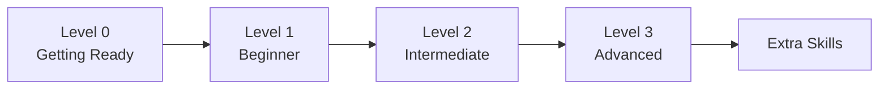

 

  

---

## Introduction

Becoming a proficient backend developer with Node.js requires a solid understanding of many concepts, tools, and technologies. This roadmap takes you step by step from the fundamentals of programming and the web, through building and securing real APIs, to running backend systems in production and designing them at scale.

> [!TIP]
> **How to use this roadmap**
>
> 1. **Go in order.** Understand the foundation before the tool: databases before ORMs, Node.js before Express, and the advanced topics only after you understand every building block.
> 2. **Pick one.** Where a section says "pick one" (a SQL database, an ORM), choose one and master it instead of learning them all.
> 3. **Follow the numbers.** Numbers next to some courses, like `videos 1-3`, tell you which videos of that playlist to watch.
> 4. **Expand the lists.** Every topic list is collapsed. Click it to expand.

---

## Roadmap at a Glance

| Level | Focus | What you will learn |
|:---|:---|:---|
| [Level 0: Getting Ready](#level-0-getting-ready) | CS and web basics | Data structures, how the internet works, HTTP, APIs, command line, Git |
| [Level 1: Beginner](#level-1-beginner-foundations) | Foundations | HTML/CSS, JavaScript, OOP, SOLID, database design, UML |
| [Level 2: Intermediate](#level-2-intermediate-building-real-apis) | Building real APIs | Node.js, Express, MongoDB, authentication, Swagger, TypeScript, testing, deployment |
| [Level 3: Advanced](#level-3-advanced-production--scale) | Production and scale | SQL, ORMs, Redis, background jobs, NestJS, architecture, DevOps, observability, system design |
| [Extra Skills](#extra-skills--resources) | Keep growing | Docker, SDLC, operating systems, clean code, hosting, references |

## Table of Contents

- [Level 0: Getting Ready](#level-0-getting-ready)
- [Level 1: Beginner (Foundations)](#level-1-beginner-foundations)
- [Level 2: Intermediate (Building Real APIs)](#level-2-intermediate-building-real-apis)
- [Level 3: Advanced (Production & Scale)](#level-3-advanced-production--scale)
- [Extra Skills & Resources](#extra-skills--resources)

 

 

# Level 0: Getting Ready

> Before starting Node.js, the fundamentals need to be solid first. A strong backend roadmap starts with the internet, Git, databases, and data structures, not with a framework.

## 1. Computer Science Foundations

<b>Topics</b>

- Problem Solving
- Data Structures Basics
- Algorithms Basics
- OOP Basics

<b>Resources</b>

- [Data Structures - Hard Code](https://youtube.com/playlist?list=PLwCMLs3sjOY4UQq4vXgGPwGLVX1Y5faaS&si=6Jv0oLsnTlXC_aUG)
- [Data Structures](https://www.youtube.com/watch?v=owCqVRbZlbg&list=PLCInYL3l2AajqOUW_2SwjWeMwf4vL4RSp)
- [Data Structures Easy to Advanced Course](https://www.youtube.com/watch?v=RBSGKlAvoiM)
- [Programiz Website](https://www.programiz.com/dsa/data-structure-types)
- [Introductions to Algorithms](https://www.youtube.com/watch?v=8hly31xKli0&t=2s)
- [Grokking Algorithms](https://bit.ly/3xl71jO)

## 2. How the Web Works

**Web fundamentals to cover:** `Internet`, `Client / Server`, `HTTP`, `DNS`, `API`, `JSON`

<b>How the Internet Works</b>

- [Backend Preparation Video: Client Server Model | Dynamic Sites | MVC | HTTP Protocol](https://www.youtube.com/watch?v=ToHfYbxg3ms&list=PLIzoD6CTXb3_iILDz7NIGj49stmeoDWh0&index=3)
- [How the Internet Works](https://www.youtube.com/watch?v=7_LPdttKXPc)
- [How does the internet work? (Full Course)](https://www.youtube.com/watch?v=zN8YNNHcaZc)
- [كيف يعمل الإنترنت؟](https://www.youtube.com/watch?v=TnMNDQHB33Q)

<b>اساسيات ومفاهيم الشبكات</b>

- [IT DOSE](https://youtube.com/playlist?list=PL8s4OGp0649_e_Wbz5MlBgW5rBW-9hD0c&si=vS9s1HhCT4A7WchD)

<b>Understanding HTTP</b>

- [HTTP Crash Course & Exploration](https://www.youtube.com/watch?v=iYM2zFP3Zn0)
- [Everything you need to know about HTTP](https://cs.fyi/guide/http-in-depth)

<b>Understanding APIs</b>

- [What is an API?](https://www.youtube.com/watch?v=s7wmiS2mSXY)
- [ما هو الـ API و ما فائدته في البرمجة؟ و كيف يعمل؟](https://www.youtube.com/watch?v=rq7DvjN1Gco)

<b>How Browsers Work</b>

- [How does a browser work ? | Engineering side](https://www.youtube.com/watch?v=5rLFYtXHo9s)

<b>رحلة الطلب من المتصفح للسيرفر (OSI Layers)</b>

- [OSI Layers](https://www.youtube.com/watch?v=A31bxOyj5mk&t=10s)

> [!NOTE]
> You need to search for new terms after this video.

## 3. Developer Fundamentals

<b>Topics</b>

- Git & GitHub (commits, branches, merging, pull requests)
- Command Line
- Environment Variables

<b>Command Line Basics</b>

- [كورس أساسيات Command Line](https://www.youtube.com/watch?v=wmZMMcm7zWA)
- [[Arabic] Learn Command Line #01 - Intro and What's Shell, Terminal, CMD](https://www.youtube.com/watch?v=JVs2Ywy7wGQ&list=PLDoPjvoNmBAxzNO8ixW83Sf8FnLy_MkUT)

 

 

# Level 1: Beginner (Foundations)

> Build the programming and data foundations that everything else sits on.

## 1. Frontend Essentials *(Optional)*

> [!NOTE]
> You don't need to be a frontend developer, but you should be able to read HTML and CSS and understand what the browser receives from your server. Stick to the basics, then go deeper if you like.

<b>Crash courses</b>

- [HTML Crash Course - Bro Code](https://youtu.be/HD13eq_Pmp8?si=jEW2Nxyk8aJOpoVg)
- [CSS Crash Course - Abdelrahman Gamal](https://youtu.be/Z-5QVutAEW4?si=FkTzBlGzZ5yP2Tlt)
- [HTML & CSS Crash Course - Codezilla](https://youtu.be/aHzw_8wWl48?si=PmETNMumc8xUhFGR)
- [HTML & CSS Crash Course - DesignCourse](https://youtu.be/MBlkKE0GYGg?si=ZmO11hTfnhtzOOen)

<b>Going deeper</b>

- [HTML In One Video - Elzero](https://youtu.be/qfPUMV9J5yw?si=tijM34kcGBM6vSbL)
- [CSS In One Video - Elzero](https://youtu.be/qyVkLebgfzY?si=yRWGDMZh3xaWxsR2)
- [HTML CSS Design 1 - Elzero](https://youtu.be/_-eh8cwGGwg?si=kbi6hqePJ2OmQMA6)
- [HTML CSS Design 2 - Elzero](https://youtu.be/heuDmrEAgUA?si=ILHCoishYlqtZSjl)

## 2. JavaScript Core

<b>Topics</b>

- Basic Syntax: data types, variables, operators, control flow
- Arrays, Objects & Array Methods
- Loops
- Functions & Higher Order Functions
- Hoisting & Scope
- Classes
- Data Structures (Map, Set)
- Destructuring
- Regular Expressions
- Closures
- DOM Manipulation, Browser BOM, Web APIs
- AJAX & JSON
- Asynchronous Programming: Event Loop, Promises, Async/Await
- Error Handling
- Modules

<b>Resources</b>

- [JavaScript Course - Elzero](https://youtube.com/playlist?list=PLDoPjvoNmBAx3kiplQR_oeDqLDBUDYwVv)
- [Modern JavaScript Tutorial - Net Ninja](https://youtube.com/playlist?list=PL4cUxeGkcC9haFPT7J25Q9GRB_ZkFrQAc)
- [Asynchronous JavaScript - Net Ninja](https://youtube.com/playlist?list=PL4cUxeGkcC9jx2TTZk3IGWKSbtugYdrlu)
- [W3Schools JavaScript Tutorial](https://www.w3schools.com/js/default.asp)
- [ES6 JavaScript - Yallacode](https://youtu.be/sdKG6pF8Wyg)
- [JavaScript Course - Abdelrahman Gamal](https://youtube.com/playlist?list=PLknwEmKsW8OuTqUDaFRBiAViDZ5uI3VcE)
- [CodeCademy JavaScript Course](https://www.codecademy.com/enrolled/courses/introduction-to-javascript)
- [JavaScript Tutorial - SuperSimpleDev](https://youtu.be/EerdGm-ehJQ)
- [JS Advanced Tutorial](https://youtube.com/playlist?list=PLYyqC4bNbCIdvviLNbvYKfvHqszFPnUkj&si=C-pLeGflaEGv-4j7)

## 3. Object-Oriented JavaScript

- [JavaScript OOP Course](https://youtube.com/playlist?list=PLDoPjvoNmBAzLyvrWPwMw6bbBlTwPxgLF)

## 4. SOLID Design Principles

- [SOLID Principles - Omar Ahmed](https://youtube.com/playlist?list=PLwWuxCLlF_uevri_OpofVLXkRRFnZ7TSV)
- [SOLID Principles in JS - Mahmoud Abdullah](https://youtube.com/playlist?list=PLOldSEMXUdZvAyid_1BWHnExKObbKeajJ)
- [SOLID Principles in JS - Rethinking UI](https://youtu.be/m2GCb-x8e5s)

## 5. Database Foundations

> Before any ORM, the database itself needs to be understood first.

<b>Topics</b>

- DBMS
- Relational vs NoSQL
- Tables & Relationships
- Primary / Foreign Keys
- Normalization
- ERD

**Database types**

| Type | Examples | Notes |
|:---|:---|:---|
| **Relational (SQL)** | PostgreSQL, MySQL, SQL Server, SQLite | Pick one, usually PostgreSQL |
| **Non-Relational (NoSQL)** | MongoDB | Document-based data |

<b>Resources</b>

- [Database Design Course - freeCodeCamp.org](https://www.youtube.com/watch?v=ztHopE5Wnpc)
- [Database Course](https://maharatech.gov.eg/course/view.php?id=740)

## 6. Modeling with UML

- [UML Diagrams Full Course - FreeCodeCamp](https://www.youtube.com/watch?v=WnMQ8HlmeXc)
- [Visual Paradigm UML Guide](https://www.visual-paradigm.com/guide/uml-unified-modeling-language/what-is-uml/)
- [UML Distilled Guide](https://github.com/gcoronelc/PECI-Java-MAR-2015/blob/master/Recursos/UML%20Distilled%203rd%20Ed.pdf)

## 7. JavaScript Internals

- [Shadow Coding](https://youtube.com/playlist?list=PLS-MrzRLZtmf_3nji2sHZ66hpga2pWXmR&si=HTKRQIQ4Zn2NWcp2)

 

 

# Level 2: Intermediate (Building Real APIs)

> This is where real backend building begins. By the end of this level you should be able to **build, secure, document, test, and deploy** a complete API.

## 1. Node.js Essentials

> Once JavaScript is solid, understand Node.js itself before working with any framework.

<b>Topics</b>

- Node.js Runtime & V8 Engine
- Event Loop
- npm and other package managers (pnpm, yarn)
- Modules (CommonJS / ES Modules)
- `process` & Environment Variables
- File System & Path
- Events
- HTTP Module
- Streams & Buffers Basics
- Worker Threads & Cluster (handling CPU-heavy work)
- Other runtimes and frameworks (awareness only): Bun, Deno, Fastify, Koa, Hono

<b>Resources</b>

- [Node.js Tutorial - codeZone (videos 1-3)](https://youtube.com/playlist?list=PLQtNtS-WfRa8OF9juY3k6WUWayMfDKHK2)
- [Node.js - KMR Script (videos 1-6)](https://youtube.com/playlist?list=PLL2zWZTDFZzgxxD66mv95I8hC0pby5bdp)
- [NodeJS - تخاريف مبرمج (videos 1-20)](https://youtube.com/playlist?list=PLkzDzmo9y3VG_pByjuxE7uuLYvmWgfBub)
- [NodeJS crash course - Net Ninja (videos 1-5)](https://youtube.com/playlist?list=PL4cUxeGkcC9jsz4LDYc6kv3ymONOKxwBU&si=Ykek7ZSGagh1oeQG)
- [Node.js basics - Academind (videos 1-6)](https://youtube.com/playlist?list=PL55RiY5tL51oGJorjEgl6NVeDbx_fO5jR&si=u1qEQETs-hXFtZBA)
- [W3Schools Node.js Tutorial](https://www.w3schools.com/nodejs/default.asp)

## 2. Express.js: Building the Server

<b>Core Concepts</b>

- Express.js Fundamentals
  - Routing
  - Middleware
  - Controllers & Services
  - Request/Response Handling
  - Static Files & Template Engines
  - Configuration & Environment Management
  - Cookies
  - API Versioning

<b>Database Integration</b>

- MongoDB Integration
  - Basic Setup and Connection
  - Schema Design
- CRUD Operations
- Mongoose ODM
  - Models and Schemas
  - Validation
  - Population
  - Middleware

<b>API Development</b>

- RESTful API Design
  - HTTP Methods, Status Codes, Headers
- JSend Specification
  - Success, Error, and Fail Responses
- Environment Configuration
  - dotenv Setup
  - Configuration Management
- Pagination, Filtering, Sorting, Searching
  - Limit and Offset
  - Cursor-based Pagination
- CORS Configuration
  - Cross-Origin Requests
  - Security Headers
- Request Validation
  - Zod, Joi, express-validator
- Logging
  - Morgan, Winston, Pino
- HTTP Caching
  - ETag, Cache-Control
- API Design Extras
  - Idempotent endpoints, soft deletes, consistent error codes

<b>Security & Authentication</b>

- Error Handling
  - Global Error Handler
  - Custom Error Classes
  - Error Middleware
- Authentication & Authorization
  - User Authentication
  - Role-based Access Control (RBAC)
  - Permission Management
- Protected Routes
  - Route Guards
  - Middleware Protection
- Session Management & Tokens
  - Session-based Auth
  - JWT Implementation (Access & Refresh Tokens)
  - Token Management & Rotation
  - Logout & Account Invalidation
- Hashing vs. Encryption
  - Password Hashing
  - Data Encryption
  - Best Practices
- OAuth 2.0 Integration
  - Social Login (Google Login)
  - Third-party Authentication
- Passport.js Implementation
  - Local Strategy
  - JWT Strategy
  - OAuth Strategies
- Email Verification & Password Reset
- Two-Factor Authentication (2FA / MFA) & Magic Links
- API Keys & Service-to-Service Auth
- Managed Auth Providers (Auth0, Clerk, Firebase Auth) and when to use them
- Web Security
  - CSRF
  - XSS Basics
  - SQL / NoSQL Injection
  - Helmet & Secure Cookies
  - Secrets Management
  - [OWASP Top 10](https://owasp.org/www-project-top-ten/)

<b>File Operations</b>

- File Upload with Multer
  - Single File Upload
  - Multiple Files
  - File Filtering
  - Storage Configuration
- Cloud Storage

<b>Real-time Features</b>

- WebSocket Integration
- Socket.IO Setup
- Real-time Events
- Room Management
- Real-Time Notifications, Presence & Live Updates
- Server-Sent Events (SSE)
- Scaling Socket.IO with the Redis adapter
- WebRTC Implementation *(optional, not essential for the backend track)*
  - Peer-to-peer Connection
  - Media Streaming
  - Data Channels

<b>Performance & Traffic Control</b>

- Rate Limiting
  - Request Throttling
  - API Rate Limits
  - DDoS Protection
- Traffic Control
  - Load Balancing
  - Request Queuing
  - Traffic Management

<b>Resources</b>

- [Express.js & MongoDB Course - codeZone (videos 4-11)](https://youtube.com/playlist?list=PLQtNtS-WfRa8OF9juY3k6WUWayMfDKHK2)
- [Youssef Abbas](https://youtube.com/playlist?list=PL5gCk5NdNx586mk_JOhe30dd59IgrFG_U&si=e6gr4Lx6N23zk4NW)
- [KMR Script (videos 7-63)](https://youtube.com/playlist?list=PLL2zWZTDFZzgxxD66mv95I8hC0pby5bdp)
- [Emam Academy (videos 13-79)](https://youtube.com/playlist?list=PLGhZWewM_75LQf3KvHo6HHSclmDyDazl7)
- [Express.js Tutorial](https://www.tutorialspoint.com/expressjs/index.htm)
- [Code With Zeyad - authentication](https://youtu.be/GsqkTEvnC8s?si=G0mAiLR2O4BzB4Qv)
- [Almdrasa - OAuth](https://www.youtube.com/watch?v=86qNjL7I00w)
- [Algorithm Academy - passport.js](https://www.youtube.com/playlist?list=PLfDx4cQoUNOZ6BVx8IuvTdrxiRQhDHmPK)
- [Youssef Abbas - Blog App](https://youtube.com/playlist?list=PL5gCk5NdNx58jcohY_gnMR2WI1Lhl2uNK&si=NcfucyoDpIoD9vO3)

## 3. MongoDB & NoSQL

<b>Topics</b>

- Collections & Documents
- Schema Design
- CRUD Operations
- Aggregation Pipeline
- Indexing
- When to choose NoSQL over SQL

<b>Resources</b>

- [Mohamed Ramdan - MongoDB Course](https://youtube.com/playlist?list=PLd6o9p13Lc5387FWk_GXU0Rh5AhrBGod5&si=iMA4rPjm8tMNl3zH)
- [Academind - MongoDB](https://www.youtube.com/watch?v=VELru-FCWDM)

## 4. API Testing & Documentation

<b>Topics</b>

- Postman
- Swagger / OpenAPI
- API Contracts
- Documentation rules

<b>Resources</b>

- [QAcart - Postman Course](https://youtube.com/playlist?list=PLJ2FoWouEU2yPMIBTGsMRvxjEevIlMi3F&si=lLDRz8DsraSzZXMJ)
- [Automation - Postman](https://youtu.be/wEOLZq-7DYs?si=5oyiIANh75HKCziQ)
- [Muhammed Essa - Swagger Api design and documentation](https://youtube.com/playlist?list=PLMYF6NkLrdN_CelwcY-B9PPi4UsXmU8Ka&si=ENybozmt2WnbTwOT)
- [Braintemple - API documentation with Swagger](https://youtube.com/playlist?list=PLnBvgoOXZNCOiV54qjDOPA9R7DIDazxBA&si=BB7Q-aTXKtYCifiH)

## 5. Rendering Strategies: SSR vs CSR

- [Amr Mohamed - Server-Side vs Client-Side Rendering Explained](https://www.youtube.com/watch?v=zAJs2T1xAFE)

## 6. TypeScript for Backend

> Useful on most modern Node.js teams. Recommended once you are comfortable with Express.

<b>Topics</b>

- Syntax & Types, Interfaces, Generics, Utility Types
- `tsconfig`, running TypeScript with `tsx` / `ts-node`
- Using TypeScript with Express
- Type-safe validation with Zod

<b>Resources</b>

- [TS - Elzero](https://youtube.com/playlist?list=PLDoPjvoNmBAy532K9M_fjiAmrJ0gkCyLJ&si=iWwrKEkOryhbHciU)
- [TS - Yousef Abbas](https://youtube.com/playlist?list=PL5gCk5NdNx5_QxWasJ3msGjlpB7hs1-nF&si=WF3tOiAqt78sx9ur)
- [TS - Index Academy](https://youtube.com/playlist?list=PLDQ11FgmbqQNDkXDd5SScLPqJM5w4Kgjc&si=_85SuQV_DTDVKEsu)
- [TS - Simple Arab Code](https://youtube.com/playlist?list=PLxRKoQzM5m3KsId3ITGOiRG7UVXz18HLP&si=P1daEdb1lGVTq6pZ)
- [TS - Scripter Efendi](https://youtube.com/playlist?list=PLAhPJ5tzB6ALRWCae49De5C6aEs04PcCk&si=66Ed9n4YccFTZPnw)
- [Express with TypeScript - Anson the Developer](https://youtu.be/Be7X6QJusJA?si=KI2bUSw-zc4shX4a)

## 7. Project Architecture & Design Patterns

<b>Topics</b>

- MVC
- Controller / Service / Repository
- Separation of Concerns
- Dependency Injection (concept)
- Design Patterns Basics
- SOLID (see the resources in [Level 1](#4-solid-design-principles))
- Clean Code

<b>Resources</b>

- [Introduction to MVC Architecture with ExpressJs and NodeJs - PedroTech](https://www.youtube.com/watch?v=Cgvopu9zg8Y)
- [Design Patterns - AbuGhazaleh](https://www.youtube.com/watch?v=2Q69R0GD9zM)
- [MVC pattern - Piyush Garg](https://www.youtube.com/watch?v=JLtXoru-ipo)

## 8. Testing & Code Quality

<b>Topics</b>

- Unit Testing, Integration Testing, API Testing
- Jest / Vitest & Supertest
- End-to-End (E2E) Testing
- Test Coverage
- Mocking
- Test Database
- Documentation: Swagger / OpenAPI, API Contracts
- Linting & Formatting (ESLint, Prettier)
- Git Hooks (Husky, lint-staged) & Conventional Commits
- Git Branching, Pull Requests, Code Review

<b>Resources</b>

- [Unit Testing with Jest - Anson the Developer](https://www.youtube.com/watch?v=K-9IPd3oAoo)
- [Testing a MongoDB-ExpressJS-NodeJS](https://youtube.com/playlist?list=PLJetLDY7yKurTuyZZhZCC136VAs8BEdOo&si=p_tIItp6A8ZMTGhl)
- [Software Testing - Tresmerge](https://youtube.com/playlist?list=PLzNfs-3kBUJllCa8_6pLYDMnIlg6Lfvu4&si=XDoQo8IHICrUlC_9)
- [JavaScript Unit Testing with Jest - Elzero](https://youtube.com/playlist?list=PLDoPjvoNmBAwSrfBPERTnCmWAbcMAwG9O&si=fiSO0qLUYSV3_Kjl)

## 9. Deploying Your First App

- [Deployment to Vercel](https://www.youtube.com/watch?v=vCuf62T2snY)
- [Deployment to Azure App Service](https://youtube.com/playlist?list=PLLasX02E8BPADO_R-D6ctSoV4EeE8ow9B&si=21Oh06vU9UN5NS8V)
- [Deployment on Vercel (2)](https://youtu.be/IeM1PGqmJT4?si=djO4OcC6dsIWR7yW)
- [Deployment on Netlify](https://youtu.be/hQAu0YEIF0g?si=OSESA1bo1g-KmevT)

> [!IMPORTANT]
> **Practice project:** build a blog or task-manager API with authentication, validation, pagination, Swagger docs, and tests, then deploy it.

 

 

# Level 3: Advanced (Production & Scale)

> The shift from junior CRUD developer to backend engineer, and from "I know backend" to "I know how to run backend in production."

## 1. SQL Databases

**Pick one SQL database (usually PostgreSQL).**

<b>SQL topics</b>

- CRUD
- SELECT / WHERE
- JOIN
- GROUP BY & Aggregation
- Subqueries
- Views
- Constraints
- Indexes

<b>MySQL</b>

- [MySQL Fundamentals Tutorial - CodeRK](https://youtu.be/K9o0mRuqzqQ?si=qqpNHnY3OXvKX3Sy)
- [Advanced MySQL Techniques - Big Data](https://youtu.be/kb-_GbpH3sQ?si=0kYRmy6N0h92lXpq)
- [MySQL - TheNewBaghdad](https://youtube.com/playlist?list=PLF8OvnCBlEY25O_Ql0CrgQUAc5NVYkWF2&si=3NNmclm8uYJm6hA1)
- [MySQL - freeCodeCamp.org](https://www.youtube.com/watch?v=HXV3zeQKqGY)
- [MySQL - Traversy Media](https://youtu.be/9ylj9NR0Lcg?si=f1LtNVDlqdmLgBGR)

<b>PostgreSQL</b>

- [PostgreSQL - Mohamed Gbreel](https://youtube.com/playlist?list=PLqmv-PiN1b7hLJ_2ktdE9YX7Ba_7UZq3f&si=UK_KOv-_lcUgs_5S)
- [PostgreSQL - Troi](https://www.youtube.com/watch?v=zw4s3Ey8ayo)

<b>SQL Server</b>

- [SQL - Korsat X Parmaga](https://youtu.be/N-WPYk417yE?si=7MU3PrWX1Mu0PyVB)
- [SQL - Metigator](https://youtube.com/playlist?list=PL4n1Qos4Tb6RP_OovpgjoHLkCVaYFy-aj&si=LGocJvsBHjusN5rM)
- [SQL - Kevin Stratvert](https://www.youtube.com/watch?v=h0nxCDiD-zg)

<b>SQLite</b>

- [SQLite Fundamentals](https://youtu.be/7DQnyLIXEZw?si=F5Jw9yfumRymJ_vg)
- [SQLite (2)](https://youtu.be/IBgWKTaG_Bs?si=zGHSoPgxEEFdq5P8)

## 2. Relational Schema Design

<b>Database Internals</b>

- Transactions
- ACID
- Isolation Levels
- Locks
- Concurrency
- Deadlocks

<b>Database Practices</b>

- Seeding & test data
- Soft deletes, timestamps & audit logs
- Connection pooling (and PgBouncer for PostgreSQL)
- Backups & restore
- Full-text search in PostgreSQL

<b>Resources</b>

- [Database Design - bedoo Bader](https://youtube.com/playlist?list=PLC7aGATfqnIj6p1GIzk4X13Xdv3T8rBzJ&si=b9UrtCpDgHd0SmKA)
- [Database Design - SAF1](https://www.youtube.com/watch?v=CQlfm_zNIgo)
- [Database Design - Very Academy](https://youtube.com/playlist?list=PLOLrQ9Pn6caxigVJw2jHwIpH7gdb1zrmu&si=2X6yAqrItPvdcTtn)
- [Database Design - Database Star](https://youtube.com/playlist?list=PLZDOU071E4v6epq3GS0IqZicZc3xwwBN_&si=A0fYBYRASFubBOWs)

## 3. Using SQL from Node.js

- [SQL in Node.js - KMR Script](https://www.youtube.com/watch?v=SIxgA9CP1A8)
- [SQL in Node.js (2)](https://www.youtube.com/watch?v=JR_wlj72dTQ)
- [SQL in Node.js - Software3](https://www.youtube.com/watch?v=-ClOcI8giAA)
- [SQL in Node.js (4)](https://www.youtube.com/watch?v=_n-Ai30C1qs)
- [Node Postgres Official Website](https://node-postgres.com/)
- [Node.js SQL Tutorial](https://www.youtube.com/watch?v=9JrnEO3W2Ys)

## 4. ORMs & Query Builders

<b>Topics</b>

- The general idea: why use an ORM instead of raw SQL
- ORM vs Query Builder vs raw SQL: when to use each
- Schema, Relations, Querying, Migrations, Transactions
- Type-safe queries and database seeding

<b>General resources</b>

- [What are ORMs Playlist](https://youtube.com/playlist?list=PLfDx4cQoUNObHX28K6FS38LkB2CPLGGfx&si=l6HXOBq4_3TTNnJ-)
- [ORM Comparison Tutorial](https://youtu.be/3Pxj-4IrOcs?si=VGVaPNnWXWxsw7ma)
- [ORM Deep Dive](https://www.youtube.com/watch?v=8WoeGcJ_nNM)

> [!NOTE]
> Sequelize, Prisma, TypeORM, and Drizzle all serve the same purpose, so you don't have to learn all of them. Start with one, and revisit another later if a project needs it.

<b>Prisma</b>

- [Prisma Fundamentals](https://www.youtube.com/watch?v=RebA5J-rlwg)
- [Prisma Playlist](https://youtube.com/playlist?list=PLf42-srNPbi1iwPI4pRMLIcbqW-lF5R9T)
- [Prisma Migrate Documentation](https://www.prisma.io/docs/orm/prisma-migrate)

<b>Drizzle ORM</b>

TypeScript-first and SQL-like, lightweight, and works with PostgreSQL, MySQL, and SQLite. A great modern choice if you like writing queries that stay close to SQL.

- Schema definition in TypeScript
- Type-safe queries and relational queries
- Drizzle Kit: generating and running migrations

**Docs**

- [Drizzle ORM Documentation](https://orm.drizzle.team/docs/overview)
- [Drizzle Migrations Documentation](https://orm.drizzle.team/docs/migrations)

<b>Sequelize</b>

- [Sequelize Playlist](https://youtube.com/playlist?list=PLkqiWyX-_Lov8qmMOVn4SEQwr9yOjNn3f&si=zXOmykVHDdS70PCc)
- [Sequelize (2)](https://youtu.be/zA_HkejB-0s?si=7R7Znli0UCXyeBkx)
- [Sequelize Migrations Documentation](https://sequelize.org/docs/v6/other-topics/migrations/)

<b>TypeORM</b>

- [TypeORM Fundamentals](https://www.youtube.com/watch?v=Reb7ISQZCvA)
- [TypeORM (2)](https://www.youtube.com/watch?v=JaTbzPcyiOE)
- [TypeORM (3)](https://www.youtube.com/watch?v=JfIvPDPUFo4)

<b>Query Builders: Kysely & Knex</b>

For when you want more control than an ORM but less repetition than raw SQL.

- [Kysely](https://kysely.dev/)
- [Knex.js](https://knexjs.org/)

## 5. Schema Migrations

- [Database Migrations Tutorial](https://youtu.be/TmVRKDoMulE?si=qn9sHCOBrkXbelbG)

## 6. Automation & Web Scraping (Puppeteer)

<b>Topics</b>

- Puppeteer Basics
- Practical use cases

<b>Resources</b>

- [Puppeteer Automation Playlist 1](https://youtube.com/playlist?list=PLRmEk9smitaXljDN2CjwZ96o4Aj87iuC5&si=hrGsjUs99r3gCcIl)
- [Puppeteer Scraping Playlist 2](https://youtube.com/playlist?list=PLuJJZ-W1NwdqgvE0D-1SMS7EpWIC5cKqu&si=yhMjk1QKfTOBp-mA)

## 7. Payments Integration

> Useful depending on your path.

<b>Topics</b>

- Payment Integration Concepts
- Stripe / Paymob and others

<b>Resources</b>

- [Payment Integration Playlist](https://youtube.com/playlist?list=PLkzDzmo9y3VETa2XvIch29djB47v4zJQS&si=6SX1Cz0Hci15vWSx)
- [Payment Gateway Tutorial 1](https://www.youtube.com/watch?v=mI_-1tbIXQI)
- [Payment Gateway Tutorial 2](https://www.youtube.com/watch?v=isakqT0fOsY)

## 8. Redis, Caching & Performance

<b>Redis</b>

- Caching, Cache Invalidation, TTL, Cache Aside
- Redis Data Structures
- Sessions, rate limiting and Pub/Sub with Redis

<b>Performance</b>

- Query Optimization & Database Indexing
- N+1 Problem
- Connection Pool
- Pagination Optimization
- Response Time & Load Testing

<b>API Protection</b>

- Rate Limiting
- Throttling

<b>Resources</b>

- [Redis Fundamentals](https://youtu.be/XP32O_gMZkA?si=kM2lW6h9KsDPJ_VQ)
- [Redis (2)](https://www.youtube.com/watch?v=bP4BeUjNkXc)
- [Redis (3)](https://www.youtube.com/watch?v=jgpVdJB2sKQ)

## 9. Background Jobs & Scheduling

<b>Topics</b>

- Cron Jobs & Scheduled Tasks in Node.js
- Job Queues (BullMQ / Redis Queues)
- Retry & Backoff
- Dead Letter Concepts

<b>Resources</b>

- [Task Scheduling (1)](https://www.youtube.com/watch?v=Ezv30i47sDs)
- [Task Scheduling (2)](https://www.youtube.com/watch?v=StkFajPnd7w)
- [Task Scheduling Node JS](https://youtu.be/ZG0Fl5Ejq68?si=ZDS-wkQSdc4XTMPu)

## 10. NestJS (Framework Track)

> Optional alternative framework to Express.

<b>Getting Started</b>

- [ ] Node.js and npm/yarn installation
- [ ] TypeScript setup and configuration
- [ ] NestJS CLI installation and basic commands
- [ ] Project structure and architecture
- [ ] Understanding modules, controllers, and providers

<b>1 Core Concepts</b>

- [ ] Dependency Injection
- [ ] Decorators usage
- [ ] Modules organization
- [ ] Controllers and routing
- [ ] Providers and services
- [ ] Middleware
- [ ] Exception filters
- [ ] Pipes and validation
- [ ] Guards
- [ ] Interceptors

<b>2 Database Integration</b>

**TypeORM**

- [ ] Database connection setup
- [ ] Entity creation and relationships
- [ ] Repository pattern
- [ ] Migrations
- [ ] Query builder

**Prisma / Drizzle (optional)**

- [ ] Using Prisma or Drizzle instead of TypeORM

**Mongoose**

- [ ] MongoDB connection
- [ ] Schema definition
- [ ] Model creation
- [ ] CRUD operations

<b>3 Authentication & Authorization</b>

- [ ] Passport integration
- [ ] JWT implementation
- [ ] Guards and strategies
- [ ] Role-based access control (RBAC)
- [ ] OAuth2 implementation

<b>4 Advanced Concepts</b>

**API Documentation**

- [ ] Swagger/OpenAPI integration
- [ ] API documentation best practices
- [ ] Decorators for API documentation

**Testing**

- [ ] Unit testing with Jest
- [ ] E2E testing
- [ ] Test coverage
- [ ] Mocking services

**WebSockets**

- [ ] WebSocket implementation
- [ ] Gateway creation
- [ ] Real-time events
- [ ] Socket.io integration

**Microservices**

- [ ] Microservices architecture
- [ ] Message patterns
- [ ] Transport layers
- [ ] gRPC implementation
- [ ] Redis/RabbitMQ integration

<b>5 Performance & Security</b>

**Caching**

- [ ] Cache implementation
- [ ] Redis cache
- [ ] Cache strategies

**Security**

- [ ] Helmet integration
- [ ] CORS configuration
- [ ] Rate limiting
- [ ] Security best practices

**Performance**

- [ ] Performance optimization
- [ ] Logging
- [ ] Monitoring
- [ ] Error handling

<b>6 Deployment & DevOps</b>

- [ ] Docker containerization
- [ ] CI/CD pipeline setup
- [ ] Environment configuration
- [ ] Production best practices
- [ ] Monitoring and logging in production

<b>Official docs & courses</b>

**Official docs**

- [NestJS Official Documentation](https://docs.nestjs.com/)
- [NestJS GitHub Repository](https://github.com/nestjs/nest)

**Courses**

- [NestJS Courses - Index Academy](https://youtube.com/playlist?list=PLDQ11FgmbqQP1aaCCiU74LzebvZjY_S4G&si=bpzkYNm5nOWmp7T9)
- [NestJS - Anson the Developer](https://youtube.com/playlist?list=PL_cUvD4qzbkw-phjGK2qq0nQiG6gw1cKK&si=5jffg-5TP0sqbDs4)
- [NestJS - Sakura Dev](https://youtube.com/playlist?list=PLhnVDNT5zYN_PfPXedWpMy_UTeYNExbfR&si=OSbJzrpOkxvaDs1T)
- [NestJS - Mahmoud Abdullah](https://youtube.com/playlist?list=PLOldSEMXUdZsFAEJwxYkE83dhm1ZkWEOL&si=PvdFNjTv09cJNxzj)
- [NestJS - freeCodeCamp.org](https://youtu.be/sFnAHC9lLaw?si=rNCLnOCQ56PEeyPO)
- [NestJS - Code With tkssharma](https://www.youtube.com/watch?v=i1wN86rnMEI&list=PLIGDNOJWiL1_YrquGbDDN4BNNRy678Spr)
- [Microservice with Nest.JS - Mahmoud Abdullah](https://youtu.be/-z_ZtIy5MpE?si=o1HrF021CKf1e_0G)

## 11. Production Engineering

> [!IMPORTANT]
> Study these after you understand all the building blocks above. This is the difference between **building an API** and **running a backend system**.

<b>Event-Driven Basics</b>

- Events
- Producers / Consumers
- Pub/Sub
- RabbitMQ
- Kafka (concepts)

<b>Production-Grade APIs</b>

**API Engineering**

- Advanced Pagination, Filtering, Sorting, Search
- API Versioning
- Response Standardization
- Validation
- Error Handling & Logging
- Configuration Management

**File & External Services**

- File Upload & Cloud Storage (AWS S3, Cloudinary)
- Email / SMS (Nodemailer, SendGrid, Resend, Twilio)
- Third-party APIs
- Webhooks
- Idempotency Keys
- Feature Flags (concept)

<b>API Styles Beyond REST</b>

- GraphQL (Apollo Server): [GraphQL Learn](https://graphql.org/learn/)
- gRPC: [gRPC Docs](https://grpc.io/docs/)
- tRPC (for full-stack TypeScript projects): [tRPC Docs](https://trpc.io/docs)
- WebSockets & Server-Sent Events
- Choosing between REST, GraphQL, and gRPC

<b>Search & Storage</b>

- Elasticsearch / OpenSearch basics
- Full-text search
- Object Storage (S3-compatible) & presigned URLs
- CDN basics

<b>Advanced Database & Concurrency</b>

- Transactions & Isolation Levels
- Optimistic / Pessimistic Locking
- Deadlocks & Race Conditions
- Atomic Updates
- Idempotency
- Distributed Locks
- Read Replicas & Database Scaling

This is where real system design questions start to show up:

- What happens if two requests arrive at the same time?
- What if the operation fails mid-transaction?
- What if the user clicks Pay twice?
- What if 1000 requests hit the same resource?

<b>Software Architecture & Distributed Systems</b>

> This comes after understanding all the backend components, not at the start.

- Modular Monolith
- Layered Architecture
- Clean Architecture
- Repository Pattern
- Dependency Injection
- SOLID & Design Patterns
- Load Balancing & Horizontal Scaling
- Stateless Services
- Service Discovery (concept)
- Message Brokers
- Event-Driven Architecture
- Microservices

<b>DevOps, CI/CD & Cloud</b>

- Linux Basics
- Docker & Docker Compose
- Nginx
- Environment Management
- CI/CD with GitHub Actions: automated tests, build & deployment
- AWS Basics (Compute, Storage, Database, Networking)
- HTTPS, SSL/TLS & reverse proxies
- Kubernetes Basics (Pods, Deployments, Services)
- Infrastructure as Code (Terraform, optional)

Resources: see **Docker & Containers** and **Hosting** in [Extra Skills](#extra-skills--resources).

<b>Observability & Reliability</b>

**Observability**

- Structured Logging
- Metrics & Monitoring
- Health Checks
- Tracing Basics
- Error Tracking
- Tools: [OpenTelemetry](https://opentelemetry.io/), [Prometheus](https://prometheus.io/), [Grafana](https://grafana.com/), [Sentry](https://sentry.io/)

**Reliability**

- Timeouts & Retries
- Circuit Breaker
- Graceful Shutdown
- Rate Limiting
- Fault Tolerance

<b>System Design</b>

> The final stage, once all the backend building blocks are understood.

- Requirements & Constraints
- Trade-offs
- Scalability, Availability, Consistency
- Components: Load Balancer, Cache, Database, Queue, Object Storage, Search, CDN
- Case studies: E-Commerce, Booking System, Notification System, Ride-Hailing, Payment System, Chat System, URL Shortener

> [!IMPORTANT]
> **Practice project:** build an e-commerce backend with payments, background jobs, caching, rate limiting, Docker, CI/CD, and logging, then write down the design decisions you made.

 

 

# Extra Skills & Resources

<b>Docker & Containers</b>

- [Docker - Free Code Camp - English](https://www.youtube.com/watch?v=fqMOX6JJhGo)
- [Docker - TechWorld with Nana - English](https://www.youtube.com/results?search_query=TechWorld+with+Nana+Docker+Tutorial+for+Beginners)
- [Docker Practical Course - Arabic](https://www.youtube.com/results?search_query=docker+%D9%83%D9%88%D8%B1%D8%B3+%D8%B9%D9%85%D9%84%D9%8A+%D8%B9%D8%B1%D8%A8%D9%8A)

<b>Software Engineering: SDLC, Agile & DevOps Workflow</b>

- [Software Development Lifecycle (SDLC)](https://youtu.be/pES-vyion48?si=gvrv7Orwg4QtlZQa)
- [Agile Workflow](https://youtu.be/i-QyW8D3ei0?si=eT-KAuKxFtExf2PC)

<b>Operating Systems</b>

- [Operating Systems - Berkeley](https://youtube.com/playlist?list=PLGLfVvz_LVvSuz6NuHAzpM52qKM6bPlCV&si=sjA2ZNRSyqkSJZ-1)

<b>Clean Code & Refactoring</b>

- [Clean Code](https://www.google.com/search?q=Clean+Code+Robert+C.+Martin+book)
- [Refactoring To Patterns](https://www.google.com/search?q=Refactoring+To+Patterns+Joshua+Kerievsky+book)
- [Martin Fowler](https://martinfowler.com/)

<b>Hosting</b>

- [Hosting Explained](https://youtu.be/GFwcrCQukHU?si=F8AvV86fKgHlVWrD)
- [Hosting Practical Guide](https://youtu.be/AXVZYzw8geg?si=mdJrUqjt-JSc8M-r)

<b>Official Docs & References</b>

- [Node.js Documentation](https://nodejs.org/docs/latest/api/)
- [MDN Web Docs](https://developer.mozilla.org/en-US/docs/Learn)
- [The Twelve-Factor App](https://12factor.net/)
- [roadmap.sh Backend Roadmap](https://roadmap.sh/backend)

<b>Recommended Reading</b>

- Designing Data-Intensive Applications (Martin Kleppmann)
- Clean Architecture (Robert C. Martin)
- System Design Interview (Alex Xu)

---

### Embrace your Node.js journey with curiosity and determination.

Keep searching for knowledge and new solutions as you build powerful applications and unlock your potential.

**Happy Learning!**

